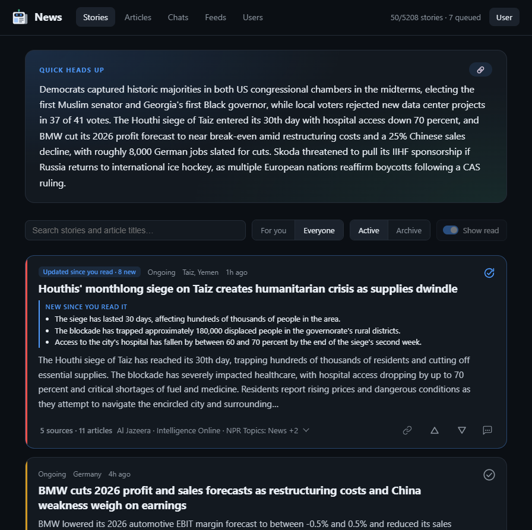
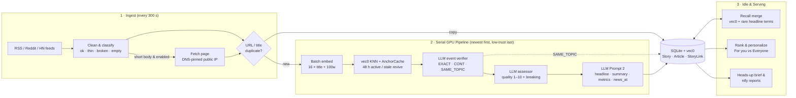
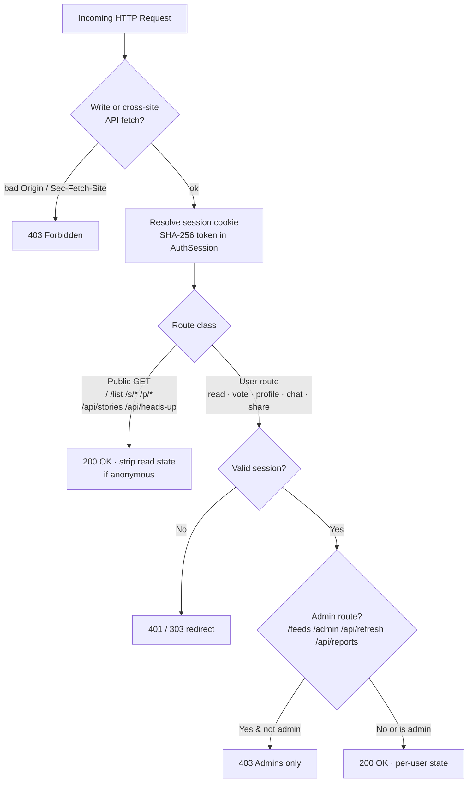

# AI News Aggregator

Local-first web app that ingests RSS feeds, clusters related articles into
**stories** with a local LLM, summarizes them, scores their quality and
ranks them for several users. Stories, summaries and classifications are shared;
preferences, votes, read state, story chats and personal briefs are per user.
Everything lives in one SQLite file (`news.db`, including the `sqlite-vec`
embedding table) plus HTTP calls to Local LLM and SearXNG.



## Quickstart & Deployment

Requirements: [uv](https://docs.astral.sh/uv/) (Python 3.14) and an Ollama
instance (`OLLAMA_BASE_URL`, default `http://127.0.0.1:11434`) serving a chat model
(`NEWS_CHAT_MODEL`, default `qwen3:14b`) and an embedding model (`NEWS_EMBED_MODEL`,
default `qwen3-embedding:0.6b`, 1024-dim). Prompts and thresholds were tuned on a Qwen3 27B
(Q3 quant) + `qwen3-embedding:0.6b`; see [Swapping models](#swapping-models) before using others.

```bash
cp .env.example .env           # set NEWS_AUTH_PASSWORD, models, optional services
uv sync
uv run python main.py          # foreground → http://127.0.0.1:8787
scripts/start.sh               # or detached (log: server.log, rotated + gzipped; pid: news.pid)
scripts/shutdown.sh [secs]     # graceful stop of every instance of this checkout, SIGKILL after timeout (default 20 s)
uv run pytest                  # tests (fake LLM, temp DB)
```

Only one server runs per checkout: `main.py` holds an exclusive lock on `news.pid.lock` and a
second start exits right away (before it would start workers and the ntfy scheduler). When the
systemd user unit (`news-server.service`, override with `NEWS_SYSTEMD_UNIT`) is enabled or
active, `start.sh` / `shutdown.sh` go through `systemctl --user` (a server killed behind
systemd's back is restarted by `Restart=on-failure`). The unit logs to the journal unless `.env`
sets `NEWS_LOG_FILE=server.log`.

Put settings in a gitignored `.env` next to `main.py` (`start.sh` sources it; template: [.env.example](.env.example)):

```bash
NEWS_AUTH_PASSWORD='long random password (>= 20 chars)'
NEWS_PUBLIC_BASE=https://news.example.org   # Secure cookie, HSTS, CSRF Origin check
NEWS_HOST=0.0.0.0                           # only without a local reverse proxy (default 127.0.0.1)
```

- **Login is required**: startup fails unless `NEWS_AUTH_PASSWORD` is set or an admin already has a stored password. `admin` (user 1) signs in with `NEWS_AUTH_PASSWORD` (until setting a custom password in ⚙ Preferences). Admins manage feeds (`/feeds`) and users (`/admin`: create, promote/demote, reset password, delete). A fresh install has no feeds: add them on `/feeds`.
- **Optional services**: SearXNG for web search in story chats (`NEWS_SEARCHNGX_BASE_URL`; empty = no web search), [ntfy](https://ntfy.sh) pushes of the daily brief (`NEWS_HEADS_UP_NTFY_URL`), and an Umami/Tianji-style analytics script (`NEWS_ANALYTICS_SCRIPT_URL`, `NEWS_ANALYTICS_WEBSITE_ID`).

### Swapping models

Every LLM call goes through one of four roles; each can use its own Ollama model (empty = `NEWS_CHAT_MODEL`):

| Role | Variable | Used for | Notes |
| --- | --- | --- | --- |
| Chat | `NEWS_CHAT_MODEL` | story chat, heads-up brief, default for the roles below | free text, thinking allowed |
| Verifier | `NEWS_VERIFY_MODEL` | clustering decision (`EXACT_MATCH` … `UNRELATED`), recall merge, tag synonyms | most quality-critical; schema-constrained, temperature 0 |
| Assessor | `NEWS_ASSESS_MODEL` | article quality 1–10 + breaking flag | runs on every article; a small model is often fine |
| Story writer | `NEWS_STORY_MODEL` | headline, summary, tags, metrics, update significance | longest prompts (up to `NEWS_CONTEXT_BUDGET_CHARS`) |
| Embeddings | `NEWS_EMBED_MODEL` / `NEWS_EMBED_DIM` | clustering candidates, merge, split, search | thresholds are tuned to `qwen3-embedding` |

Structured calls use Ollama's native `/api/chat` with a JSON schema (`format`) and `think: false`, so the model must support structured outputs. Each model that differs from the others needs its own VRAM (`NEWS_OLLAMA_KEEP_ALIVE` keeps all of them loaded).

**Other servers**: set `NEWS_LLM_BASE_URL` to any OpenAI-compatible base URL ending in `/v1` (llama.cpp `llama serve`: `http://127.0.0.1:9931/v1`; [Tianji AI Router](https://tianji.dev/docs/ai-router/usage): `https://<tianji>/api/ai-router/<workspaceId>/<routerId>/openai/v1`; Ollama itself: `http://127.0.0.1:11434/v1`) and, if needed, `NEWS_LLM_API_KEY` (sent as `Authorization: Bearer`). All LLM roles then use `/chat/completions`, structured calls with `response_format: {type: json_schema}`. Embeddings stay on Ollama unless `NEWS_EMBED_BASE_URL` (+ `NEWS_EMBED_API_KEY`) points to a server with `/embeddings` (llama.cpp with a pooling model; the Tianji router has none). Ollama's `think: false` has no OpenAI equivalent: `NEWS_LLM_STRUCTURED_EXTRA` (JSON) is merged into structured requests, e.g. `{"chat_template_kwargs": {"enable_thinking": false}}` for Qwen3 on llama.cpp / vLLM, so chat answers can still think. Run `model_check.py` after switching.

Example: chat model on the GPU and embeddings on the CPU with two llama.cpp servers (the old Ollama split):

```bash
llama-server -m Qwen3-27B-Q3_K_M.gguf --alias qwen3-27b -ngl 99 -c 81920 -np 1 --jinja --port 8080
llama-server -m Qwen3-Embedding-0.6B-Q8_0.gguf --alias qwen3-embedding --embedding --pooling last \
  -ngl 0 -c 8192 -ub 8192 --port 8081
```

```bash
NEWS_LLM_BASE_URL=http://127.0.0.1:8080/v1                 # or the Tianji router in front of it
NEWS_CHAT_MODEL=qwen3-27b
NEWS_LLM_STRUCTURED_EXTRA='{"chat_template_kwargs":{"enable_thinking":false}}'
NEWS_EMBED_BASE_URL=http://127.0.0.1:8081/v1                # always direct: the router has no /embeddings
NEWS_EMBED_MODEL=qwen3-embedding
```

Prompt 2 sends up to `NEWS_CONTEXT_BUDGET_CHARS` (200k chars ≈ 50k tokens), so the chat server needs that context per slot (`-c` / `-np`). Before switching embeddings, check that the new server returns the same vectors as the old Ollama model (else stored and new vectors don't compare): `model_check.py --embed-vs-ollama <old Ollama model> --only embed` (cosine ≥ 0.99 = no re-embed needed).

Before switching, compare the candidate with the current model on the bundled fictional test cases (no database needed):

```bash
uv run python scripts/benchmark/model_check.py --save current.json                       # current models
uv run python scripts/benchmark/model_check.py --model qwen3:8b --baseline current.json  # all LLM roles
uv run python scripts/benchmark/model_check.py --verify-model gemma3:12b --only verify --baseline current.json
uv run python scripts/benchmark/model_check.py --embed-model bge-m3 --only embed
```

It prints per-role scores (verifier merge F1 and class accuracy, quality ordering and breaking accuracy, valid Prompt 2 replies and update-significance accuracy, embedding AUC and recall at the retrieval threshold), the median latency, and PASS / WARN / FAIL against minimum bars (exit code 1 on FAIL). It is a smoke test: for the verifier, also run `scripts/benchmark/benchmark_clustering.py --labels <pairs> --llm` on labeled pairs from your own database.

A new embedding model changes the cosine scale: re-check `NEWS_CLUSTER_*`, `NEWS_MERGE_SIM_THRESHOLD`, `NEWS_SPLIT_*` and `NEWS_SEARCH_MIN_SIM` (`scripts/search_probe.py`), and with a different dimension start with a new database or re-embed all articles (the `Article_Vectors` table is created with `NEWS_EMBED_DIM`).

### Reverse proxy (`nginx`, HTTPS)

```nginx
limit_req_zone $binary_remote_addr zone=news_login:1m rate=10r/m;

location / {
    proxy_pass http://127.0.0.1:8787;
    proxy_set_header Host $host;
    proxy_set_header X-Forwarded-For $proxy_add_x_forwarded_for;
    proxy_set_header X-Forwarded-Proto $scheme;
    proxy_read_timeout 1h;   # SSE stream + slow chat replies
    client_max_body_size 64k;
}
location = /api/auth/login {
    limit_req zone=news_login burst=5 nodelay;
    proxy_pass http://127.0.0.1:8787;
    proxy_set_header Host $host;
    proxy_set_header X-Forwarded-For $proxy_add_x_forwarded_for;
    proxy_set_header X-Forwarded-Proto $scheme;
}
```

## Architecture & Data Flow



1. **Ingest** (`app/ingest.py`, `app/dedup.py`): fetches the enabled feeds concurrently (disabled feeds are not fetched at all; ETag / Last-Modified, except validators with non-ASCII bytes; 5 MB cap; a bot wall that answers the browser UA with a 403 or a redirect without `Location` is retried with the feed-reader UA `NEWS_FEED_USER_AGENT`; a failing feed is retried after a doubling delay up to `NEWS_FEED_BACKOFF_MAX_HOURS`; on shutdown queued feeds are skipped and a half-read feed is fetched in full next run). Normalizes bodies (`content_quality.clean_body`; Reddit/HN items keep post text + up to `NEWS_SOCIAL_MAX_COMMENTS` comments); a longer `<content:encoded>` beats a teaser description. Enabled feeds with short descriptions fetch the linked article HTML (`trafilatura` → `newspaper3k` → `BeautifulSoup`; link-list extractions such as related-article sidebars are rejected) via a DNS-pinned client that connects only to vetted global IPs. Cross-feed duplicates (canonical URL or ≥ 5-word title within 72 h) attach directly to the original's story without LLM calls.
2. **Pipeline** (`app/pipeline.py`, `app/clustering.py`, `app/harness.py`, `app/story.py`): processes pending articles newest-first (feeds with a general trust `< 0.5` like most of Reddit wait until higher-trust backlog clears; `broken` bodies are skipped). Before each batch it self-heals: placeholder stories, and bodies one feed served identically under ≥ 3 titles (site chrome) are re-extracted and re-processed.
   - **Embed**: title + first 100 body words (title-only unless `ok`), batched in chunks of `NEWS_EMBED_BATCH` (16) and stored as the article is processed.
   - **Cluster**: `vec0` KNN retrieves candidates scored by max cosine similarity to non-broken member anchors (`AnchorCache`). The LLM verifier (`NEWS_VERIFY_MODEL`) classifies top candidates (`≥ 0.55` within 48 h, or `≥ 0.62` stale revival); `EXACT_MATCH` / `CONTINUING_DEVELOPMENT` join, `SAME_TOPIC_DISTINCT_EVENT` is saved in `StoryLink` as a related story.
   - **Harness**: scores article quality (1–10, capped at `NEWS_TITLE_QUALITY_MAX` for non-`ok` bodies) and `breaking` in one schema-constrained call. Thin articles joining a junk story skip Harness & Prompt 2, and so do word-for-word copies (`≥ NEWS_COPY_SKIP_SIM` = 0.9 cosine to a full-text member that already contains every word; one new word means a possible new fact, so the article runs normally). Copies take the member's quality.
   - **Prompt 2**: generates/updates headline, 2–4 sentence summary, tags, `location`, `language`, and anchored `metrics` (`urgency_level`, `impact_scale`, `status`), retrying once on malformed JSON; a summary over `NEWS_SUMMARY_MAX_CHARS` is sent back once for shortening, then cut at a sentence end. Story quality is the **trust-weighted median** of member articles. Incremental rewrites rate `update_significance` (0–3): `≥ 1` advances `news_at` (recency), `≥ 2` (or urgency jump / Breaking) advances `material_at` (resurfaces read stories).
3. **Recall merge** (`app/merge.py`): when the queue is empty, up to 5 recently updated stories are checked against neighbours (`≥ 0.62` cosine to stories updated within 96 h, or `≥ 3` shared rare headline terms in `_TermIndex` to catch cross-language/title-only pairs). Only `EXACT_MATCH` merges (the larger story keeps its id; a user who voted on both keeps the newer vote, and material updates of the absorbed story still resurface read stories); non-merge verdicts are cached in `StoryLink` so unchanged pairs are never re-verified.
   - **Split** (`app/split.py`): article-level `CONTINUING_DEVELOPMENT` joins can still chain a saga into one catch-all story. A story with `≥ 30` articles of which `≥ 10 %` of the pairs are unrelated (cosine `< 0.4`; coherent stories stay under 5 %) is regrouped by embedding (centroid cosine `≥ 0.6`, groups `< 3` fold in, parts `≥ 0.8` alike rejoin). The largest part keeps the story (votes, chat, links); the others become new stories that inherit read marks, are linked as related (`StoryLink` source `split`, which the merge pass never re-verifies), and get a full Prompt 2 rewrite (one story per run). Preview with `uv run python scripts/split_stories.py`.
4. **Ranking v2** (`app/scoring.py`, details and rationale in [docs/algorithms.md](docs/algorithms.md)): all features are 0..1, freshness multiplies.
   ```math
   \begin{aligned}
   \text{public} &= 0.30\,\text{quality} + 0.22\,\text{coverage} + 0.16\,\text{urgency} + 0.12\,\text{impact} + 0.12\,\text{velocity} + 0.08\,\text{status} \\
   \text{personal} &= \text{public} + 0.30\,\text{tag\_affinity} + 0.08\,\text{geo} \\
   \text{score} &= 100 \cdot \text{freshness}(\text{news\_at}) \cdot \text{soft\_cap}(\text{value} + \text{update\_boost})
   \end{aligned}
   ```
   - **Quality**: trust-weighted median of member article qualities (cross-feed copies of one article count once). **Coverage**: $`1 - e^{-\text{outlet\_trust}/2}`$ over the summed trust of distinct outlets (`outlet_key` by hostname without `www.`/`feeds.`/`rss.` prefixes, merged via `NEWS_OUTLET_GROUPS`; multiple feeds from one publisher count once), using the source trust: set for everyone on the Feeds page (category trust in `FeedCategory`, per-feed exceptions in `Feed.trust`), overridable per user in ⚙ Preferences (own feed value > own category value > general). Cards show this outlet count as "N sources" (feed count in the tooltip).
   - **Personalization** (`view=personal`): tag affinity from the explicit tag list (a tag at `≤ -10` mutes its stories) or learned weights (decayed 👍/👎 and story chats, scaled by tag specificity), `geo` from home city/country/language and region/location tag matches, excluded feeds (`⊘`), and hiding read stories. `view=default` (**Everyone**) uses `public` only, shows all stories (including read), and shares the same Quick Heads Up brief as signed-out visitors.
   - **Tag synonyms** (`app/tags.py`, `app/tag_merge.py`): static EN/DE aliases plus approved `TagAlias` rows (daily embedding + LLM verifier pass; review with `scripts/merge_tags.py`), applied at read time.
   - **Search** (`app/search.py`, `q`): word matches from the `StorySearch` FTS5 index (headline, tags, summary, article titles; diacritics folded, all words required, 3+ letter words as prefix) for everyone. Signed in, the query is also embedded and matched against article vectors (best article per story, cosine `≥ NEWS_SEARCH_MIN_SIM` and within `NEWS_SEARCH_SIM_MARGIN` of the best); the embedding gets 1.5 s, then words only. Both lists are merged by weighted Reciprocal Rank Fusion (meaning at half weight) plus a small priority boost; no variety rerank, read stories included. Meaning-only hits show a **Related** badge. Calibrate with `scripts/search_probe.py`.
5. **Retention** (`app/retention.py`, hourly): deletes stories/articles older than `NEWS_RETENTION_DAYS` (30), records URL tombstones (30 d) so feeds don't re-import them, keeps `FeedbackLog` snapshots, and runs `incremental_vacuum`.

## Authentication, Access Control & Sharing



- **Sessions & passwords** (`app/auth.py`): passwords use salted `scrypt` (`AppUser.password_hash`). Cookie tokens are 256-bit (`HttpOnly`, `SameSite=Lax`, `Secure` on HTTPS); only `sha256(token)` is stored in `AuthSession` (TTL ~10 months = 7200 h, max 500 sessions, survives restarts). Changing your password revokes sibling sessions; changing `NEWS_AUTH_PASSWORD` invalidates env-password sessions via `env_stamp`. Login and password changes are rate-limited (5 failures / 60 s per client IP, using the right-most `X-Forwarded-For` hop from a local proxy); after 10 failures on one account from any IPs, further attempts pause (1 s doubling up to 5 min) except from IPs that account signed in from before. Unknown user names cost the same scrypt run as known ones. Failures are logged as `login failed ip=<ip> user=<name>` (and `login throttled ...`), e.g. for fail2ban.
- **SSRF & hardening** (`app/api.py`, `app/ingest.py`): strict CSP (`script-src 'self'`), `X-Frame-Options: DENY`, HSTS on HTTPS (`NEWS_PUBLIC_BASE` or the request scheme), CSRF `Origin` check against `Host`/`NEWS_PUBLIC_BASE` (`Origin: null` rejected), `Sec-Fetch-Site: cross-site` block on private APIs and `cross-site`/`same-site` block on writes, DNS-pinned public-IP page fetching, feed/page bodies streamed with a 5 MB cap, single-flight heads-up generation, 50-stream SSE cap, signed-out story list cap (200).
- **Sharing**: stories share via `/s/<id>` (public default view). Briefs and chat answers are snapshotted via `POST /api/share` into `ShareLink` (`/p/<token>`: 8-char token for the default brief, 32-char unguessable token for personal briefs and chat answers) and can be listed or revoked in ⚙ Preferences.

## UI & Pages

- **Stories (`/`)** — Quick Heads Up brief (per view, background regeneration with `(updating…)` indicator and fade-in, 🔗 share), search, **For you / Everyone** toggle, **Active / Archive** toggle, **Show read** toggle, `#tag` filter chips. Read marks and 👍/👎 clicked while the server is unreachable are kept in the browser (`localStorage`, up to 24 h) and sent once it is back; each carries its age, and the server ignores one older than a change made meanwhile (e.g. on another device), so the later click wins. Cards show the summary (collapsed cards clamp to ~400 chars; full text on expand — ↻ resurfaced stories add "New since you read it": up to 3 new facts reported after your read mark); clicking expands tags, metrics, relevance breakdown and **Related stories**; the sources bar expands member articles (`new` badges since read). Card actions: ✓ read/unread, 🔗 share `/s/<id>`, 👍/👎 feedback, **💬 Ask** per-story chat (**Web search** toggle on by default — the AI decides by itself whether and how deep to search via SearXNG; collapsible thinking/search/search/read/error steps, `✎` message editing with `‹ n/m ›` version switching, ↻ retry after Stop, 🔗 answer share; answers run as **server-side background jobs** (`app/chat_jobs.py`, at most `NEWS_CHAT_MAX_JOBS_PER_USER` at once): closing the popup or reloading keeps them running, clicking beside the popup leaves a bubble (bottom right) with progress and ready state, only **Stop** aborts (the partial answer is saved), and ✎ is always available afterward). A **↻ Refresh** button appears once the view is ≥ 10 min old.
- **Chats (`/chats`)** — your story chats, newest first; unread answers and ones in progress on top (the tab shows the unread count).
- **Articles (`/list`)** — flat article table with search, status filter (`assigned / pending / duplicate / skipped / dead`), sort toggle, stage timings (`Wait / Embed / Cluster / Harness / Story / Work / Latency / Merge`) and worker status bar.
- **Feeds (`/feeds`, admins)** — add feed (auto-fetches `<title>`), edit name / feed URL / website URL (✎), recategorize, source trust per category and per feed (empty = the category's), delete, enable/disable per feed or category (a disabled feed is not fetched), collapsible categories (remembered in the browser), 24 h / 7 d volume and error filter.
- **Users (`/admin`, admins)** — create users, toggle admin role, set passwords, delete users, view vote/read/chat counts.
- **⚙ Preferences** — *About you* (tailors personal brief & chat), home city/country/language, interest regions & locations, minimum quality, own category & per-feed trust (sliders start at the general values, ↺ resets one, "reset all" all) + `⊘` feed exclusions, scheduled ntfy reports (admins), tag weights (compact up/down-weighted `#tag` chips, click a chip to edit its number, × to delete), password change, and **Shared links** (open / revoke).

## API Summary

| Endpoint | Access | Purpose |
| --- | --- | --- |
| `GET /api/stories` · `GET /api/stories/{id}` | Public | Ranked/archived stories (`view=personal\|default`, `q`, `tag`, `hide_read`, `keep`) with `articles` and `related` |
| `GET /api/stories/pulse?since=` | Public | Cheap poll: stories with news after `since` + queue size (drives the "↑ N new" pill) |
| `POST` / `DELETE /api/stories/{id}/read` | User | Mark story read / unread ("New since you read it" comes from `StoryUpdate`); `?age=` seconds since an offline click |
| `GET/POST /api/stories/{id}/chat` · `POST .../chat/switch` | User | Per-story chat tree; POST starts a background answer and streams it as NDJSON (`step`, `thinking`, `delta`, `done`; 409 while one runs, 429 over the per-user cap; `edit_of` branches, `switch` selects version) |
| `GET .../chat/stream` · `POST .../chat/stop` · `POST .../chat/read` · `GET /api/chats` | User | Re-attach to a running answer (replay + live, 204 if none) · stop it · mark answers seen · chat list with unread / running state |
| `GET /api/heads-up?view=` | Public | Non-blocking top-5 brief (`default` or `personal`; triggers background refresh when stale) |
| `POST /api/feedback` · `GET /api/feedback` | User | 👍/👎 vote (`up\|down`, or `null` to undo; optional `age` for offline clicks) · vote log |
| `GET/PUT /api/profile` | User | Preferences (`about`, `home_*`, `interest_regions`, `locations`, `min_quality`, `excluded_feeds`, `ntfy_reports`), `tag_weights`, `source_weights`, `feed_weights` |
| `POST /api/share` · `GET /api/share` · `GET/DELETE /api/share/{token}` | User / Public `GET {token}` | Create snapshot (`/p/<token>`), list own links, view snapshot (public), revoke link |
| `GET /api/health` | Public | `{"ok": true}`; DB/worker health for signed-in users |
| `GET /api/articles` | User | Article timing table (`/list`) |
| `GET /api/events` | User | SSE stream |
| `GET /api/auth/session` · `POST /api/auth/login` · `POST /api/auth/logout` · `POST /api/auth/password` | Public / User | Session probe, login (`username`, `password`), logout, change own password |
| `GET/POST /api/feeds` · `PATCH/DELETE /api/feeds/{id}` · `POST /api/feeds/category` · `GET /api/feeds/preview` | Admin | Feed & category management |
| `POST /api/refresh` · `GET /api/reports/{kind}` · `POST /api/reports/{kind}/send` | Admin | Start ingest+pipeline in the background (`{"started": false}` while one runs) · preview / push `brief` or `pipeline` ntfy report |
| `GET/POST /api/admin/users` · `PATCH/DELETE /api/admin/users/{id}` | Admin | User management (user 1 stays admin; no self-demotion/deletion) |

## Configuration (`app/config.py`)

| Variable | Default | Meaning |
| --- | --- | --- |
| `OLLAMA_BASE_URL` / `NEWS_OLLAMA_KEEP_ALIVE` | `http://127.0.0.1:11434` / `15m` | Ollama server / model keep-alive |
| `NEWS_CHAT_MODEL` / `NEWS_EMBED_MODEL` / `NEWS_EMBED_DIM` | `qwen3:14b` / `qwen3-embedding:0.6b` / `1024` | Default LLM and embedding model (see [Swapping models](#swapping-models)) |
| `NEWS_VERIFY_MODEL` / `NEWS_ASSESS_MODEL` / `NEWS_STORY_MODEL` | empty (= `NEWS_CHAT_MODEL`) | Per-role LLMs: event verifier, article quality, story writer |
| `NEWS_LLM_BASE_URL` / `NEWS_LLM_API_KEY` | empty (Ollama native) | OpenAI-compatible `/v1` endpoint (llama.cpp, Tianji AI Router, …) for all LLM calls, Bearer key |
| `NEWS_EMBED_BASE_URL` / `NEWS_EMBED_API_KEY` | empty (Ollama native) | OpenAI-compatible `/v1` endpoint for embeddings |
| `NEWS_WORKER_INTERVAL` / `NEWS_PIPELINE_BATCH` / `NEWS_EMBED_BATCH` | `300` / `50` / `16` | Ingest interval (s) / pipeline batch / texts per embed call |
| `NEWS_PIPELINE_MAX_FAILURES` / `NEWS_BACKLOG_LOW_TRUST_BELOW` | `3` / `0.5` | Dead-letter threshold / trust cutoff processed last in backlog |
| `NEWS_PIPELINE_MAX_TIMEOUTS` / `NEWS_PIPELINE_TIMEOUT_BACKOFF_MINUTES` | `6` / `15` | Ollama timeouts don't count as failures: the article retries after a doubling delay and the run pauses; parked after this many in a row |
| `NEWS_FEED_BACKOFF_MAX_HOURS` | `6` | Longest wait before retrying a failing feed (starts at `NEWS_WORKER_INTERVAL`, doubles) |
| `NEWS_FETCH_CONCURRENCY` / `NEWS_FETCH_TIMEOUT` / `NEWS_MAX_ITEMS_PER_FEED` | `16` / `20` / `10` | Feed fetch pool / timeout (s) / items per feed |
| `NEWS_CLUSTER_MODE` / `NEWS_CLUSTER_WINDOW_HOURS` | `two_stage` / `48` | `two_stage` (LLM verifier) or `cosine` / active join window |
| `NEWS_CLUSTER_VERIFY_RETRIEVE_THRESHOLD` / `NEWS_CLUSTER_SIM_THRESHOLD` / `NEWS_CLUSTER_REVIVE_SIM_THRESHOLD` | `0.55` / `0.64` / `0.62` | Verifier retrieval / cosine fallback / stale-story revival |
| `NEWS_MERGE_ENABLED` / `NEWS_MERGE_SIM_THRESHOLD` / `NEWS_MERGE_MAX_CHECKS_PER_RUN` | `1` / `0.62` / `5` | Idle-time recall merge settings |
| `NEWS_MERGE_CANDIDATE_WINDOW_HOURS` | `96` | Age limit of embedding merge candidates (checked stories stay within the 48 h window) |
| `NEWS_MERGE_LEXICAL_MIN_TERMS` / `NEWS_MERGE_LEXICAL_MAX_DF` | `3` / `5` | Shared rare headline terms for lexical merge candidates |
| `NEWS_SPLIT_ENABLED` | `1` | Split incoherent catch-all stories (`app/split.py`) |
| `NEWS_SPLIT_MIN_ARTICLES` / `NEWS_SPLIT_FAR_SIM` / `NEWS_SPLIT_FAR_PAIR_SHARE` | `30` / `0.4` / `0.10` | Split gate: size and share of unrelated article pairs |
| `NEWS_SPLIT_GROUP_SIM` / `NEWS_SPLIT_MIN_GROUP` / `NEWS_SPLIT_PART_SIM` | `0.6` / `3` / `0.8` | Grouping: join threshold, smallest part, parts that rejoin |
| `NEWS_SPLIT_MAX_PARTS` / `NEWS_SPLIT_MAX_PER_RUN` | `6` / `1` | Parts per story, stories split per pipeline run |
| `NEWS_READ_RESURFACE_SIGNIFICANCE` / `NEWS_TITLE_QUALITY_MAX` | `2` / `6` | Update significance (0–3) to resurface read stories / cap for non-`ok` bodies |
| `NEWS_SUMMARY_MAX_CHARS` | `800` | Story summary length cap (one shortening request, then cut at a sentence end) |
| `NEWS_STORY_ACTIVE_DAYS` / `NEWS_RETENTION_DAYS` / `NEWS_DEDUP_WINDOW_HOURS` | `7` / `30` / `72` | Active feed window / DB retention (0 = forever) / URL+title dedup window |
| `NEWS_BOILERPLATE_MIN_TITLES` | `3` | One feed's identical body under this many titles = extracted site chrome; re-extracted (else title-only) and re-processed |
| `NEWS_OUTLET_GROUPS` | `deutschlandfunkkultur.de=deutschlandfunk.de,act.eff.org=eff.org,wid.cert-bund.de=bsi.bund.de` | Hosts of one organization counted as one outlet (credibility, source count) |
| `NEWS_W_PUB_QUALITY` / `_COVERAGE` / `_URGENCY` / `_IMPACT` / `_VELOCITY` / `_STATUS` | `0.30` / `0.22` / `0.16` / `0.12` / `0.12` / `0.08` | Ranking v2 public value weights (sum to 1; see `docs/algorithms.md`) |
| `NEWS_FRESHNESS_HALF_LIFE_HOURS` | `Breaking=12,Ongoing=30,Resolved=12` | Multiplicative freshness half-life per status (from `news_at`) |
| `NEWS_W_AFFINITY` / `NEWS_W_GEO` / `NEWS_TAG_WEIGHT_SCALE` / `NEWS_TAG_MUTE_WEIGHT` | `0.30` / `0.08` / `4` / `-10` | "For you": tag affinity and location weight, tanh scale of tag weights, mute threshold |
| `NEWS_VOTE_WEIGHT` / `NEWS_CHAT_WEIGHT` / `NEWS_VOTE_HALF_LIFE_DAYS` | `2` / `1` / `up=60,down=90,chat=90` | Learned (inferred) tag weights from 👍/👎 and story chats |
| `NEWS_TAG_MERGE_ENABLED` / `NEWS_TAG_MERGE_REVIEW_SIM` / `NEWS_TAG_MERGE_AUTO_SIM` / `NEWS_TAG_MERGE_MAX_VERIFY` | `1` / `0.80` / `0.90` / `30` | Daily tag synonym pass (`scripts/merge_tags.py`): review / auto-merge cosine, LLM calls per run |
| `NEWS_USER_CITY` / `NEWS_USER_COUNTRY` / `NEWS_USER_LANGUAGE` | empty | Server defaults for home distance scoring (users set their own in ⚙) |
| `NEWS_HEADS_UP_TTL_MINUTES` / `NEWS_HEADS_UP_NTFY_URL` / `NEWS_HEADS_UP_NTFY_TIMES` | `11` / empty (off) / `07:00` | Brief cache TTL / ntfy endpoint / daily brief of the first admin until schedules are saved in ⚙ (each schedule is sent at most once a day, `ReportSent`) |
| `NEWS_SEARCHNGX_BASE_URL` / `NEWS_CHAT_SEARCH_MAX_TURNS` / `NEWS_CHAT_SEARCH_MAX_SECONDS` | empty (off) / `8` / `120` | SearXNG URL and safety caps on autonomous chat search (turns, time) |
| `NEWS_ANALYTICS_SCRIPT_URL` / `NEWS_ANALYTICS_WEBSITE_ID` | empty (off) | Analytics script added to every page (its origin is allowed in the CSP) |
| `NEWS_CHAT_MAX_TOKENS` / `NEWS_CHAT_STORY_MAX_ARTICLES` | `4096` / `30` | Chat answer budget (thinking included) / newest article lines in the chat system prompt |
| `NEWS_CHAT_MAX_JOBS_PER_USER` / `NEWS_CHAT_READ_PARALLEL` | `3` / `4` | Background answers per user / search-result pages read at once |
| `NEWS_SEARCH_SEMANTIC_WEIGHT` / `NEWS_SEARCH_MIN_SIM` / `NEWS_SEARCH_SIM_MARGIN` | `0.5` / `0.5` / `0.15` | Story search: weight of meaning matches in RRF (words = 1) / their cosine floor / max distance to the best one |
| `NEWS_SEARCH_SEMANTIC_TIMEOUT` / `NEWS_SEARCH_EMBED_MAX_INFLIGHT` / `NEWS_SEARCH_PRIORITY_BOOST` | `1.5` / `2` / `0.15` | Wait for the query embedding (s) / concurrent embeddings (busy → words only) / priority boost on fused scores |
| `NEWS_AUTH_PASSWORD` / `NEWS_AUTH_SESSION_HOURS` | empty / `7200` | Owner login password (required unless an admin has a stored password; startup fails otherwise) / session TTL in hours (default ~10 months) |
| `NEWS_HOST` / `NEWS_PORT` / `NEWS_PUBLIC_BASE` / `NEWS_DB_PATH` | `127.0.0.1` / `8787` / `http://127.0.0.1:8787` / `news.db` | Server bind (`0.0.0.0` = all interfaces), public base URL, SQLite path |
| `NEWS_LOG_FILE` / `NEWS_LOG_MAX_MB` / `NEWS_LOG_BACKUPS` | empty / `10` / `10` | Rotating gzipped log (`start.sh` sets `server.log`) |
| `NEWS_COPY_SKIP_SIM` | `0.9` | Word-for-word copies above this cosine skip Harness & Prompt 2 (`> 1` = off) |

## Database & Layout

`news.db` (SQLite WAL, foreign keys, `sqlite-vec`, auto-migrated via `PRAGMA user_version` in `app/db.py`). Copy it while the server runs with `uv run python -c "import sqlite3; sqlite3.connect('news.db').execute(\"VACUUM INTO 'news-copy.db'\")"` (a plain `cp` of a live WAL database can tear):
- **Shared tables**: `Feed` (incl. general `trust`), `FeedCategory` (trust per category), `Article` (timings, `content_class`, `quality`, `duplicate_of`), `Article_Vectors` (`vec0 FLOAT[1024]`), `Story` (`headline`, `summary`, `tags`, `metrics`, `quality_score`, `news_at`, `material_at`, `merge_checked_at`), `StoryLink` (pair verdicts for merge skip + related stories), `StoryAlias` (merged-away ids → surviving story), `StoryUpdate` (new facts per rated update), `ArticleTombstone`, `TagAlias` + `TagVector` (tag synonyms and their embedding cache), `StorySearch` (FTS5, kept in sync by triggers), `ReportSent` (scheduled ntfy reports sent today).
- **Per-user tables**: `AppUser`, `AuthSession` (hashed tokens), `UserProfile` (weights, feed overrides, exclusions, `about`, `home_*`, ntfy schedules), `StoryRead`, `FeedbackLog`, `MarkChange` (time of the last read/vote change, so stale offline replays lose), `ChatSession` (`seen_id` = unread tracking) + `ChatMessage` (branching tree + agent `steps`), `ShareLink`.

```
main.py                 uvicorn entrypoint, single-instance lock & PID file
app/
  api.py, web.py                App factory + auth/security middleware, shared HTTP helpers
  routes/                       One APIRouter per area (stories, chat, auth, profile, share, admin, feeds, ...); no SQL
  auth.py, users.py, bus.py     scrypt/session auth, user administration, SSE bus
  stories.py, chat_history.py, share.py, feeds.py   Story payloads & read marks, chat tree, share links, feed management
  db.py, schema.sql, config.py  SQLite + sqlite-vec bootstrap, migrations (one-off review data: tag_review.py, feed_review.py), env config
  ingest.py, content_quality.py, dedup.py, retention.py
  pipeline.py, clustering.py, merge.py, split.py, harness.py, story.py, scoring.py, diversity.py, tags.py, tag_merge.py
  heads_up.py, reports.py, chat.py, chat_jobs.py, searchngx.py, search.py, worker.py
  frontend/                     vanilla JS/CSS UI (index, list, chats, feeds, admin, share)
scripts/                start.sh, shutdown.sh, pipeline_report.py, compare_rankings.py, recluster_stories.py, split_stories.py, rescore_metrics.py, merge_tags.py, search_probe.py, benchmark/ (model_check.py, benchmark_clustering.py)
tests/                  pytest suite (API, security, pipeline, merge, split, scoring, search, read, reports, ingest, migrations, frontend JS syntax via tree-sitter)
docs/                   algorithms.md (ranking), performance.md (2026-10 AI quality audit), project_plan.md (original design), future_ideas.md, screenshot.png
```

## License

[PolyForm Noncommercial 1.0.0](LICENSE): free to use, modify and share for any noncommercial purpose (personal, hobby, research, education, nonprofits, public institutions). Commercial use needs a separate license; ask via [GitHub](https://github.com/Progaros).
