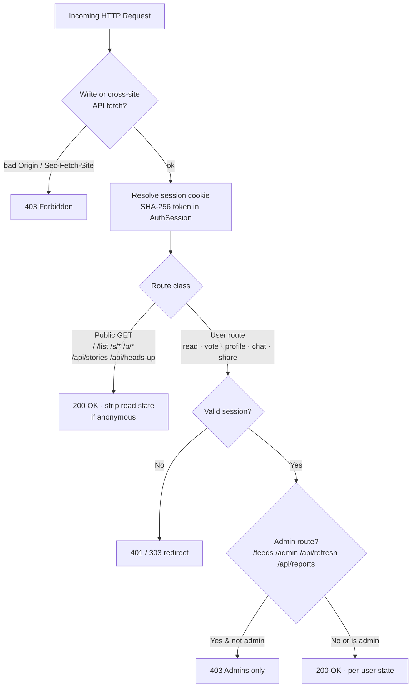

# AI News Aggregator

Local-first web app that ingests RSS feeds, clusters related articles into
**stories** with a local Ollama LLM, summarizes them, scores their quality and
ranks them for several users. Stories, summaries and classifications are shared;
preferences, votes, read state, story chats and personal briefs are per user.
Everything lives in one SQLite file (`news.db`, including the `sqlite-vec`
embedding table) plus HTTP calls to Ollama and SearXNG.

## Quickstart & Deployment

Requirements: [uv](https://docs.astral.sh/uv/) (Python 3.14) and an Ollama
instance (`OLLAMA_BASE_URL`, default `http://127.0.0.1:11434`) serving:
- chat model `qwen3:27b`
- embedding model `qwen3-embedding:0.6b-CPU` (1024-dim)

```bash
uv sync
uv run python main.py          # foreground → http://127.0.0.1:8787
scripts/start.sh               # or detached (log: server.log, rotated + gzipped; pid: news.pid)
scripts/shutdown.sh [secs]     # graceful stop, SIGKILL after timeout (default 20 s)
uv run pytest                  # tests (fake LLM, temp DB)
```

Put settings in a gitignored `.env` next to `main.py` (`start.sh` sources it):

```bash
NEWS_AUTH_PASSWORD='long random password (>= 20 chars)'
NEWS_PUBLIC_BASE=https://news.example.org   # Secure cookie, HSTS, CSRF Origin check
NEWS_HOST=127.0.0.1                         # when nginx runs on the same host
```

- **Login is required**: startup fails unless `NEWS_AUTH_PASSWORD` is set or an admin already has a stored password. `admin` signs in with `NEWS_AUTH_PASSWORD` (until setting a custom password in ⚙ Preferences). Admins manage feeds (`/feeds`) and users (`/admin`: create, promote/demote, reset password, delete).

### Reverse proxy (`nginx`, HTTPS)

```nginx
limit_req_zone $binary_remote_addr zone=news_login:1m rate=10r/m;

location / {
    proxy_pass http://127.0.0.1:8787;
    proxy_set_header Host $host;
    proxy_set_header X-Forwarded-For $proxy_add_x_forwarded_for;
    proxy_set_header X-Forwarded-Proto $scheme;
    proxy_read_timeout 1h;   # SSE stream + slow chat replies
    client_max_body_size 64k;
}
location = /api/auth/login {
    limit_req zone=news_login burst=5 nodelay;
    proxy_pass http://127.0.0.1:8787;
    proxy_set_header Host $host;
    proxy_set_header X-Forwarded-For $proxy_add_x_forwarded_for;
    proxy_set_header X-Forwarded-Proto $scheme;
}
```

## Architecture & Data Flow


1. **Ingest** (`app/ingest.py`, `app/dedup.py`): fetches feeds concurrently (ETag / Last-Modified, 5 MB cap). Normalizes bodies (`content_quality.clean_body`; Reddit/HN items keep post text + up to `NEWS_SOCIAL_MAX_COMMENTS` comments); a longer `<content:encoded>` beats a teaser description. Enabled feeds with short descriptions fetch the linked article HTML (`trafilatura` → `newspaper3k` → `BeautifulSoup`; link-list extractions such as related-article sidebars are rejected) via a DNS-pinned client that connects only to vetted global IPs. Cross-feed duplicates (canonical URL or ≥ 5-word title within 72 h) attach directly to the original's story without LLM calls.
2. **Pipeline** (`app/pipeline.py`, `app/clustering.py`, `app/harness.py`, `app/story.py`): processes pending articles newest-first (categories with `SOURCE_TRUST < 0.5` like Reddit wait until higher-trust backlog clears; `broken` bodies are skipped). Before each batch it self-heals: placeholder stories, and bodies one feed served identically under ≥ 3 titles (site chrome) are re-extracted and re-processed.
   - **Embed**: title + first 100 body words (title-only unless `ok`), batched in chunks of `NEWS_EMBED_BATCH` (16) and stored as the article is processed.
   - **Cluster**: `vec0` KNN retrieves candidates scored by max cosine similarity to non-broken member anchors (`AnchorCache`). The 27B verifier classifies top candidates (`≥ 0.55` within 48 h, or `≥ 0.62` stale revival); `EXACT_MATCH` / `CONTINUING_DEVELOPMENT` join, `SAME_TOPIC_DISTINCT_EVENT` is saved in `StoryLink` as a related story.
   - **Harness**: scores article quality (1–10, capped at `NEWS_TITLE_QUALITY_MAX` for non-`ok` bodies) and `breaking` in one schema-constrained call. Thin articles joining a junk story skip Harness & Prompt 2.
   - **Prompt 2**: generates/updates headline, 2–4 sentence summary, tags, `location`, `language`, and anchored `metrics` (`urgency_level`, `impact_scale`, `status`), retrying once on malformed JSON. Story quality is the **trust-weighted median** of member articles. Incremental rewrites rate `update_significance` (0–3): `≥ 1` advances `news_at` (recency), `≥ 2` (or urgency jump / Breaking) advances `material_at` (resurfaces read stories).
3. **Recall merge** (`app/merge.py`): when the queue is empty, up to 5 recently updated stories are checked against neighbours (`≥ 0.62` cosine to stories updated within 96 h, or `≥ 3` shared rare headline terms in `_TermIndex` to catch cross-language/title-only pairs). Only `EXACT_MATCH` merges; non-merge verdicts are cached in `StoryLink` so unchanged pairs are never re-verified.
4. **Ranking** (`app/scoring.py`):
   $$\text{relevance} = 10 \cdot (0.40\,\text{quality} + 0.35\,\text{credibility} + 0.25\,\text{impact})$$
   $$\text{display} = \text{relevance} + \text{urgency}\cdot W_1 + \text{clamp}(\text{interest}\cdot W_3, \pm 10) + \text{distance}\cdot W_{\text{dist}} - \text{decay}(\text{news\_at})$$
   - **Credibility**: summed trust of distinct outlets (`outlet_key` by hostname without `www.`/`feeds.`/`rss.` prefixes, merged via `NEWS_OUTLET_GROUPS`; multiple feeds from one publisher count once), using category/per-feed trust overrides. Cards show this outlet count as "N sources" (feed count in the tooltip).
   - **Personalization** (`view=personal`): whole-word region/location tag matches (`impact`), 👍/👎 tag weights (`interest`), home city/country/language (`distance`), excluded feeds (`⊘`), and hiding read stories. `view=default` (**Everyone**) uses `DEFAULT_PROFILE` with `distance = 0`, shows all stories (including read), and shares the same Quick Heads Up brief as signed-out visitors.
5. **Retention** (`app/retention.py`, hourly): deletes stories/articles older than `NEWS_RETENTION_DAYS` (7), records URL tombstones (30 d) so feeds don't re-import them, keeps `FeedbackLog` snapshots, and runs `incremental_vacuum`.

## Authentication, Access Control & Sharing



- **Sessions & passwords** (`app/auth.py`): passwords use salted `scrypt` (`AppUser.password_hash`). Cookie tokens are 256-bit (`HttpOnly`, `SameSite=Lax`, `Secure` on HTTPS); only `sha256(token)` is stored in `AuthSession` (24 h TTL, max 500 sessions, survives restarts). Changing your password revokes sibling sessions; changing `NEWS_AUTH_PASSWORD` invalidates env-password sessions via `env_stamp`. Login and password changes are rate-limited (5 failures / 60 s per client IP, using the right-most `X-Forwarded-For` hop from a local proxy).
- **SSRF & hardening** (`app/api.py`, `app/ingest.py`): strict CSP (`script-src 'self'`), `X-Frame-Options: DENY`, HSTS on HTTPS, CSRF `Origin` check against `Host`/`NEWS_PUBLIC_BASE`, `Sec-Fetch-Site: cross-site` block on private APIs, DNS-pinned public-IP page fetching, single-flight heads-up generation, 50-stream SSE cap.
- **Sharing**: stories share via `/s/<id>` (public default view). Briefs and chat answers are snapshotted via `POST /api/share` into `ShareLink` (`/p/<token>`: 8-char token for the default brief, 32-char unguessable token for personal briefs and chat answers) and can be listed or revoked in ⚙ Preferences.

## UI & Pages

- **Stories (`/`)** — Quick Heads Up brief (per view, background regeneration with `(updating…)` indicator and fade-in, 🔗 share), search, **For you / Everyone** toggle, **Active / Archive** toggle, **Show read** toggle, `#tag` filter chips. Cards show the full summary; clicking expands tags, metrics, relevance breakdown, "Summary when you read it" (on ↻ resurfaced stories) and **Related stories**; the sources bar expands member articles (`new` badges since read). Card actions: ✓ read/unread, 🔗 share `/s/<id>`, 👍/👎 feedback, **💬 Ask** per-story chat (**Web search** toggle on by default — the AI decides by itself whether and how deep to search via SearXNG; collapsible thinking/search/read/error steps, `✎` message editing with `‹ n/m ›` branch switching, 🔗 answer share). A **↻ Refresh** button appears once the view is ≥ 10 min old.
- **Articles (`/list`)** — flat article table with search, status filter (`assigned / pending / duplicate / skipped / dead`), sort toggle, stage timings (`Wait / Embed / Cluster / Harness / Story / Work / Latency / Merge`) and worker status bar.
- **Feeds (`/feeds`, admins)** — add feed (auto-fetches `<title>`), rename, recategorize, delete, enable/disable per feed or category, 24 h / 7 d volume and error filter.
- **Users (`/admin`, admins)** — create users, toggle admin role, set passwords, delete users, view vote/read/chat counts.
- **⚙ Preferences** — *About you* (tailors personal brief & chat), home city/country/language, interest regions & locations, minimum quality, category & per-feed trust sliders + `⊘` feed exclusions, scheduled ntfy reports (admins), editable tag weights, password change, and **Shared links** (open / revoke).

## API Summary

| Endpoint | Access | Purpose |
| --- | --- | --- |
| `GET /api/stories` · `GET /api/stories/{id}` | Public | Ranked/archived stories (`view=personal\|default`, `q`, `tag`, `hide_read`, `keep`) with `articles` and `related` |
| `POST` / `DELETE /api/stories/{id}/read` | User | Mark story read (snapshots summary) / unread |
| `GET/POST /api/stories/{id}/chat` · `POST .../chat/switch` | User | Per-story chat tree & NDJSON stream (`step`, `thinking`, `delta`, `done`; `edit_of` branches, `switch` selects version) |
| `GET /api/heads-up?view=` | Public | Non-blocking top-5 brief (`default` or `personal`; triggers background refresh when stale) |
| `POST /api/feedback` · `GET /api/feedback` | User | 👍/👎 vote (`up\|down`, or `null` to undo and revert tag weights) · vote log |
| `GET/PUT /api/profile` | User | Preferences (`about`, `home_*`, `interest_regions`, `locations`, `min_quality`, `excluded_feeds`, `ntfy_reports`), `tag_weights`, `source_weights`, `feed_weights` |
| `POST /api/share` · `GET /api/share` · `GET/DELETE /api/share/{token}` | User / Public `GET {token}` | Create snapshot (`/p/<token>`), list own links, view snapshot (public), revoke link |
| `GET /api/articles` · `GET /api/health` · `GET /api/events` | Public | Article timing table · DB/worker health · SSE stream |
| `GET /api/auth/session` · `POST /api/auth/login` · `POST /api/auth/logout` · `POST /api/auth/password` | Public / User | Session probe, login (`username`, `password`), logout, change own password |
| `GET/POST /api/feeds` · `PATCH/DELETE /api/feeds/{id}` · `POST /api/feeds/category` · `GET /api/feeds/preview` | Admin | Feed & category management |
| `POST /api/refresh` · `GET /api/reports/{kind}` · `POST /api/reports/{kind}/send` | Admin | Blocking ingest+pipeline run · preview / push `brief` or `pipeline` ntfy report |
| `GET/POST /api/admin/users` · `PATCH/DELETE /api/admin/users/{id}` | Admin | User management (user 1 stays admin; no self-demotion/deletion) |

## Configuration (`app/config.py`)

| Variable | Default | Meaning |
| --- | --- | --- |
| `OLLAMA_BASE_URL` / `NEWS_OLLAMA_KEEP_ALIVE` | `http://127.0.0.1:11434` / `15m` | Ollama server / model keep-alive |
| `NEWS_CHAT_MODEL` / `NEWS_EMBED_MODEL` | Qwen3.8-27B / qwen3-embedding:0.6b | LLM and 1024-dim embedding model |
| `NEWS_WORKER_INTERVAL` / `NEWS_PIPELINE_BATCH` / `NEWS_EMBED_BATCH` | `300` / `50` / `16` | Ingest interval (s) / pipeline batch / texts per embed call |
| `NEWS_PIPELINE_MAX_FAILURES` / `NEWS_BACKLOG_LOW_TRUST_BELOW` | `3` / `0.5` | Dead-letter threshold / trust cutoff processed last in backlog |
| `NEWS_FETCH_CONCURRENCY` / `NEWS_FETCH_TIMEOUT` / `NEWS_MAX_ITEMS_PER_FEED` | `16` / `20` / `10` | Feed fetch pool / timeout (s) / items per feed |
| `NEWS_CLUSTER_MODE` / `NEWS_CLUSTER_WINDOW_HOURS` | `two_stage` / `48` | `two_stage` (LLM verifier) or `cosine` / active join window |
| `NEWS_CLUSTER_VERIFY_RETRIEVE_THRESHOLD` / `NEWS_CLUSTER_SIM_THRESHOLD` / `NEWS_CLUSTER_REVIVE_SIM_THRESHOLD` | `0.55` / `0.64` / `0.62` | Verifier retrieval / cosine fallback / stale-story revival |
| `NEWS_MERGE_ENABLED` / `NEWS_MERGE_SIM_THRESHOLD` / `NEWS_MERGE_MAX_CHECKS_PER_RUN` | `1` / `0.62` / `5` | Idle-time recall merge settings |
| `NEWS_MERGE_CANDIDATE_WINDOW_HOURS` | `96` | Age limit of embedding merge candidates (checked stories stay within the 48 h window) |
| `NEWS_MERGE_LEXICAL_MIN_TERMS` / `NEWS_MERGE_LEXICAL_MAX_DF` | `3` / `5` | Shared rare headline terms for lexical merge candidates |
| `NEWS_READ_RESURFACE_SIGNIFICANCE` / `NEWS_TITLE_QUALITY_MAX` | `2` / `6` | Update significance (0–3) to resurface read stories / cap for non-`ok` bodies |
| `NEWS_STORY_ACTIVE_DAYS` / `NEWS_RETENTION_DAYS` / `NEWS_DEDUP_WINDOW_HOURS` | `2` / `7` / `72` | Active feed window / DB retention (0 = forever) / URL+title dedup window |
| `NEWS_BOILERPLATE_MIN_TITLES` | `3` | One feed's identical body under this many titles = extracted site chrome; re-extracted (else title-only) and re-processed |
| `NEWS_SOURCE_TRUST` / `NEWS_SOURCE_TRUST_DEFAULT` | `Reddit=0.3,Hacker News=0.5,Reviews=0.5` / `1.0` | Default category trust weights |
| `NEWS_OUTLET_GROUPS` | `deutschlandfunkkultur.de=deutschlandfunk.de,act.eff.org=eff.org,wid.cert-bund.de=bsi.bund.de` | Hosts of one organization counted as one outlet (credibility, source count) |
| `NEWS_W1` / `NEWS_W3` / `NEWS_INTEREST_CAP` / `NEWS_W_DISTANCE` | `1.0` / `1.5` / `10` / `2.0` | Display score weights (urgency, interest, cap, distance) |
| `NEWS_DECAY_HALF_LIFE_HOURS` / `NEWS_DECAY_MAX` / `NEWS_FEEDBACK_ALPHA` | `18` / `10` / `0.1` | Time decay (from `news_at`) and 👍/👎 learning rate |
| `NEWS_USER_CITY` / `NEWS_USER_COUNTRY` / `NEWS_USER_LANGUAGE` | `Munich` / `Germany` / `de` | Server defaults for home distance scoring |
| `NEWS_HEADS_UP_TTL_MINUTES` / `NEWS_HEADS_UP_NTFY_URL` / `NEWS_HEADS_UP_NTFY_TIMES` | `5` / `https://ntfy.sh/your-topic` / `07:00` | Brief cache TTL / ntfy endpoint & fallback schedule |
| `NEWS_SEARCHNGX_BASE_URL` / `NEWS_CHAT_SEARCH_MAX_TURNS` | `https://searx.example.org/` / `8` | SearXNG URL and safety cap on autonomous chat search turns |
| `NEWS_AUTH_PASSWORD` / `NEWS_AUTH_SESSION_HOURS` | empty / `24` | Owner login password (required unless an admin has a stored password; startup fails otherwise) / session TTL |
| `NEWS_HOST` / `NEWS_PORT` / `NEWS_PUBLIC_BASE` / `NEWS_DB_PATH` | `0.0.0.0` / `8787` / `http://127.0.0.1:8787` / `news.db` | Server bind, public base URL, SQLite path |
| `NEWS_LOG_FILE` / `NEWS_LOG_MAX_MB` / `NEWS_LOG_BACKUPS` | empty / `10` / `10` | Rotating gzipped log (`start.sh` sets `server.log`) |

## Database & Layout

`news.db` (SQLite WAL, foreign keys, `sqlite-vec`, auto-migrated via `PRAGMA user_version` in `app/db.py`):
- **Shared tables**: `Feed`, `Article` (timings, `content_class`, `quality`, `duplicate_of`), `Article_Vectors` (`vec0 FLOAT[1024]`), `Story` (`headline`, `summary`, `tags`, `metrics`, `quality_score`, `news_at`, `material_at`, `merge_checked_at`), `StoryLink` (pair verdicts for merge skip + related stories), `ArticleTombstone`.
- **Per-user tables**: `AppUser`, `AuthSession` (hashed tokens), `UserProfile` (weights, feed overrides, exclusions, `about`, `home_*`, ntfy schedules), `StoryRead`, `FeedbackLog`, `ChatSession` + `ChatMessage` (branching tree + agent `steps`), `ShareLink`.

```
main.py                 uvicorn entrypoint & PID file
app/
  api.py, web.py                App factory + auth/security middleware, shared HTTP helpers
  routes/                       One APIRouter per area (stories, chat, auth, profile, share, admin, feeds, ...); no SQL
  auth.py, users.py, bus.py     scrypt/session auth, user administration, SSE bus
  stories.py, chat_history.py, share.py, feeds.py   Story payloads & read marks, chat tree, share links, feed management
  db.py, schema.sql, config.py  SQLite + sqlite-vec bootstrap, migrations, env config
  ingest.py, content_quality.py, dedup.py, retention.py
  pipeline.py, clustering.py, merge.py, harness.py, story.py, scoring.py, tags.py
  heads_up.py, reports.py, chat.py, searchngx.py, worker.py
  frontend/                     vanilla JS/CSS UI (index, list, feeds, admin, share)
scripts/                start.sh, shutdown.sh, pipeline_report.py, recluster_stories.py, rescore_metrics.py, benchmark/
tests/                  pytest suite (108 tests: API, security, pipeline, merge, scoring, read, ingest, migrations)
docs/                   plan.md (changelog), todo.md, findings.md, future_ideas.md
```
