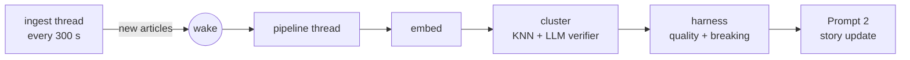

# AI News Aggregator

Local-first web app that ingests RSS feeds, clusters related articles into
**stories** with a local Ollama LLM, summarizes them, scores their quality and
ranks them for one user. Everything lives in one SQLite file (`news.db`,
including the sqlite-vec embedding table) plus HTTP calls to Ollama.

## Quickstart

Requirements: [uv](https://docs.astral.sh/uv/) (Python 3.14) and an Ollama
instance (`OLLAMA_BASE_URL`, default `http://127.0.0.1:11434`) serving

- chat model `qwen3:27b`
- embedding model `qwen3-embedding:0.6b-CPU` (1024-dim)

```bash
uv sync
uv run python main.py          # foreground → http://127.0.0.1:8787
scripts/start.sh               # or detached (log: server.log, rotated + gzipped; pid: news.pid)
scripts/shutdown.sh [secs]     # graceful stop, SIGKILL after timeout (default 20 s)
uv run pytest                  # tests (fake LLM, temp DB)
```

Feeds are managed in the UI (`/feeds`). Set `NEWS_AUTH_PASSWORD` to require a
login for everything except the read-only story views — put it (and any other
`NEWS_*` settings) in a gitignored `.env`; `start.sh` sources it.

## How it works



- **Ingest** (`app/ingest.py`): all feeds fetched concurrently (ETag /
  Last-Modified, pooled client). Bodies are normalized by
  `content_quality.clean_body` (upvoterss Reddit/HN items become the post text
  plus a "Top comments:" list of up to `NEWS_SOCIAL_MAX_COMMENTS` comments, used
  like article text for quality and summaries but not for clustering; binary
  payloads are dropped). For enabled feeds with a short post the linked HTML
  page is fetched and extracted
  (trafilatura → newspaper3k → BeautifulSoup) — except for media/social hosts
  (reddit, redd.it, youtube, x, …). Disabled feeds only store RSS rows.
  Bodies are classified `ok / thin / broken / empty` (`app/content_quality.py`).
  **Cross-feed duplicates** (same canonical URL without tracking parameters,
  or same title of ≥ 5 words within 72 h, `app/dedup.py`) skip all AI calls
  and join the original's story, where they still count as a source.
- **Retention** (`app/retention.py`, hourly): stories without an update for
  `NEWS_RETENTION_DAYS` (7) are deleted with their articles, vectors and chat;
  articles that never joined a story go after the same age. Deleted URLs are
  remembered so feeds don't re-import them; 👍/👎 votes are kept. Freed space
  is returned to the OS (incremental vacuum).
- **Pipeline** (`app/pipeline.py`), serial, newest article first, woken as soon
  as an enabled feed stored new articles; paused (no retries burned) while
  Ollama is unreachable:
  1. **Embed** title + first 100 body words (title only for non-`ok` bodies).
  2. **Cluster** (`app/clustering.py`): KNN over the vec0 index finds candidate
     stories, scored by member-anchor similarity (≥ 0.55, 48 h window); one
     constrained LLM call classifies them;
     only `EXACT_MATCH` / `CONTINUING_DEVELOPMENT` attach. Otherwise a stale
     story can be revived (≥ 0.62) or a new story is created.
     `NEWS_CLUSTER_MODE=cosine` is the no-LLM rollback (join ≥ 0.64).
  3. **Harness** (`app/harness.py`): article quality 1–10 + breaking flag in
     one schema-constrained call (headline-only for non-`ok` bodies).
  4. **Prompt 2** (`app/story.py`): headline, summary, tags, metrics,
     location, language. Urgency / impact / status follow fixed anchors
     (urgency 1–2 opinion/chatter … 9–10 live emergency). Story quality =
     median of member qualities.
  A `thin` article joining a junk story skips steps 3–4. Broken-body
  articles are never processed (`skipped`). Articles failing 3 times are
  parked (dead letter).
- **Recall merge** (`app/merge.py`): when the queue is empty, up to 5
  recently updated, not-yet-checked stories are compared with neighbouring
  stories (similarity ≥ 0.62) and verified duplicates are merged (one Prompt 2
  rewrite per merge).
- **Ranking** (`app/scoring.py`):

  ```
  relevance = 10·(quality·0.40 + credibility·0.35 + user_impact·0.25)
  display   = relevance + urgency·W1 + clamp(interest·W3, ±10) + distance·W_DISTANCE − time_decay
  ```

  credibility = distinct feeds (1 → 0.25 … 5+ → 1.0); interest = sum of
  👍/👎-learned tag weights; distance = story location/language vs
  `NEWS_USER_CITY/COUNTRY/LANGUAGE`; decay half-life 18 h, max 10. Only stories
  updated within `NEWS_STORY_ACTIVE_DAYS` are ranked; older ones are in the archive.

## UI

- **Stories (`/`)** — Quick Heads Up brief (TTL-cached, also pushed daily via
  ntfy), search, Active/Archive toggle, click a `#tag` to filter. Cards show
  sources, quality, urgency, location; expand for the relevance breakdown and
  the source articles. 👍/👎 train tag weights; **💬 Ask** opens a per-story
  chat whose answer streams in live (optionally after searchngx web-search
  turns, shown as progress). Live via SSE.
- **Articles (`/list`)** — every ingested article with search, status filter and
  timings: **Wait** (first seen → pipeline start), **Embed / Cluster / Harness /
  Story**, **Work**, **Latency** (first seen → in a story) and **Merge** (recall
  merge that moved it). The status bar shows median work vs latency, the last
  ingest and the last merge pass.
- **Feeds (`/feeds`)** — add (title auto-fetched), rename, recategorize, delete,
  enable/disable per feed or category, 24 h / 7 d volume, filter, failing feeds.
- **⚙ Preferences** — interest regions / locations (raise "impact"), minimum
  story quality, and the learned tag weights (remove or reset).

## API

| Method & path | Purpose |
| --- | --- |
| `GET /api/stories?limit=&archived=&q=&tag=` | Ranked (or archived) stories (+ total `count`, `pending`, `last_article`) |
| `GET /api/stories/{id}` | One story with its articles |
| `GET/POST /api/stories/{id}/chat` | Chat history / send `{"message", "search_turns"}` → NDJSON stream (`status`, `delta`, `done`/`error`) |
| `GET /api/articles?limit=&order=&status=&q=` | Flat article list with timings + worker status |
| `GET /api/heads-up` | AI brief over the top 5 stories |
| `POST /api/feedback` · `GET /api/feedback` | Vote `{"story_id", "kind": "up"\|"down"}` · raw vote log |
| `GET/PUT /api/profile` | Profile; PUT merges `preferences` (`interest_regions`, `locations`, `min_quality`) and replaces `tag_weights` if given |
| `GET/POST /api/feeds` · `PATCH/DELETE /api/feeds/{id}` | Feed management |
| `POST /api/feeds/category` | Enable/disable a whole category |
| `GET /api/feeds/preview?url=` | Fetch a feed's `<title>` |
| `POST /api/refresh` | Ingest now and drain the pipeline queue (blocking) |
| `GET /api/health` | Counts, pending, dead letter, worker status |
| `GET /api/events` | SSE stream |
| `GET /api/auth/session` · `POST /api/auth/login` · `POST /api/auth/logout` | Session |

With auth enabled, only `/`, `/list`, `/static/*`, the auth endpoints and
`GET` on stories (not chat), articles, heads-up, health and events are public.
Without a password (open mode) everything else is limited to LAN clients
(private/loopback addresses, judged by the address nginx appends to
`X-Forwarded-For`).
All writes are rejected when the browser's `Origin` is another site (CSRF),
responses carry a strict CSP, and the chat's web scraper only fetches public IPs.

### Behind nginx (HTTPS)

`.env` next to `main.py`:

```bash
NEWS_AUTH_PASSWORD='long random password'
NEWS_PUBLIC_BASE=https://news.example.org   # Secure cookie, HSTS, origin check
NEWS_HOST=127.0.0.1                         # nginx on the same host; else its LAN IP + NEWS_FORWARDED_ALLOW_IPS
```

```nginx
location / {
    proxy_pass http://127.0.0.1:8787;
    proxy_set_header Host $host;
    proxy_set_header X-Forwarded-For $proxy_add_x_forwarded_for;
    proxy_set_header X-Forwarded-Proto $scheme;
    proxy_read_timeout 1h;   # SSE stream + slow chat replies
}
```

## Configuration

Environment variables; defaults in [app/config.py](app/config.py).

| Variable | Default | Meaning |
| --- | --- | --- |
| `OLLAMA_BASE_URL` | `http://127.0.0.1:11434` | Ollama host |
| `NEWS_CHAT_MODEL` / `NEWS_EMBED_MODEL` | see above | models (fixed for this deployment) |
| `NEWS_OLLAMA_KEEP_ALIVE` | `15m` | keep models loaded between runs (`""` = server default) |
| `NEWS_WORKER_INTERVAL` | `300` | ingest period in seconds (start-to-start) |
| `NEWS_PIPELINE_BATCH` / `NEWS_PIPELINE_MAX_FAILURES` | `50` / `3` | pipeline batch size / dead-letter threshold |
| `NEWS_FETCH_CONCURRENCY` / `NEWS_FETCH_TIMEOUT` | `16` / `20` | parallel feed fetches / HTTP timeout (s) |
| `NEWS_MAX_ITEMS_PER_FEED` | `10` | entries read per feed per run |
| `NEWS_SOCIAL_MAX_COMMENTS` | `10` | Reddit/HN comments kept per upvoterss item |
| `NEWS_CLUSTER_MODE` | `two_stage` | `two_stage` (LLM verifier) or `cosine` (rollback) |
| `NEWS_CLUSTER_VERIFY_RETRIEVE_THRESHOLD` / `NEWS_CLUSTER_SIM_THRESHOLD` / `NEWS_CLUSTER_REVIVE_SIM_THRESHOLD` | `0.55` / `0.64` / `0.62` | retrieval / cosine-mode join / stale-story revive |
| `NEWS_CLUSTER_WINDOW_HOURS` | `48` | freshness window for joining |
| `NEWS_CLUSTER_VERIFY_MAX_CANDIDATES` / `NEWS_CLUSTER_VERIFY_TIMEOUT_SECONDS` | `3` / `60` | verifier batch size / deadline |
| `NEWS_JUNK_SKIP_QUALITY_THRESHOLD` | `2.0` | junk-join skip threshold |
| `NEWS_KNN_CANDIDATES` | `200` | nearest articles fetched from the vector index |
| `NEWS_MERGE_ENABLED` / `NEWS_MERGE_SIM_THRESHOLD` / `NEWS_MERGE_MAX_CHECKS_PER_RUN` | `1` / `0.62` / `5` | recall merge pass |
| `NEWS_STORY_ACTIVE_DAYS` | `2` | stories without updates for longer move to the archive |
| `NEWS_RETENTION_DAYS` | `7` | delete stories/articles older than this (0 = keep forever) |
| `NEWS_DEDUP_WINDOW_HOURS` / `NEWS_DEDUP_TITLE_MIN_WORDS` | `72` / `5` | cross-feed duplicate detection |
| `NEWS_W1` / `NEWS_W3` / `NEWS_INTEREST_CAP` / `NEWS_W_DISTANCE` | `1.0` / `1.5` / `10` / `2.0` | display-score weights |
| `NEWS_W_REL_QUALITY` / `_CREDIBILITY` / `_IMPACT` | `0.40` / `0.35` / `0.25` | relevance weights |
| `NEWS_DECAY_HALF_LIFE_HOURS` / `NEWS_DECAY_MAX` | `18` / `10` | time decay |
| `NEWS_FEEDBACK_ALPHA` | `0.1` | feedback learning rate |
| `NEWS_USER_CITY` / `_COUNTRY` / `_LANGUAGE` | `Munich` / `Germany` / `de` | distance sorting |
| `NEWS_HEADS_UP_TTL_MINUTES` | `3` | brief cache TTL |
| `NEWS_HEADS_UP_NTFY_URL` / `NEWS_HEADS_UP_NTFY_TIMES` | `https://ntfy.sh/your-topic` / `07:00` | scheduled push (empty disables) |
| `NEWS_AUTH_PASSWORD` / `NEWS_AUTH_SESSION_HOURS` | empty / `24` | login (empty = open mode) |
| `NEWS_CHAT_SEARCH_TURNS` | `0,1,2,3,5,7,10` | chat web-search turn options |
| `NEWS_SEARCHNGX_BASE_URL` / `NEWS_SEARCHNGX_API_KEY` | `https://searx.example.org/` / empty | web search for chat |
| `NEWS_HOST` / `NEWS_PORT` / `NEWS_DB_PATH` / `NEWS_PID_FILE` | `0.0.0.0` / `8787` / `news.db` / `news.pid` | server |
| `NEWS_PUBLIC_BASE` / `NEWS_FORWARDED_ALLOW_IPS` | `http://127.0.0.1:8787` / `127.0.0.1` | public URL (https → Secure cookie + HSTS) / trusted reverse proxies |
| `NEWS_LOG_LEVEL` | `INFO` | log level |
| `NEWS_LOG_FILE` / `NEWS_LOG_MAX_MB` / `NEWS_LOG_BACKUPS` | empty (stderr) / `10` / `10` | rotating log file, backups gzip-compressed (`start.sh` sets `server.log`) |

## Database

`news.db` (WAL, foreign keys, sqlite-vec). Timestamps are naive UTC.

- `Feed` — URL, category, `enabled` (AI on/off), HTTP cache headers, `last_error`
- `Article` — RSS item + cleaned body, `content_class`, `quality`, `story_id` (NULL =
  not in a story), `created_at` (first seen), `processed_at`, stage timings
  `t_embed_s / t_cluster_s / t_harness_s / t_story_s / t_wall_s / t_merge_s`, `pipeline_failures`
- `Story` — headline, summary, tags, metrics (urgency, impact, status,
  location, language), `quality_score`, `created_at`, `updated_at`, `merge_checked_at`
- `Article_Vectors` — vec0 `FLOAT[1024]`, cosine, primary key `article_id`
- `UserProfile`, `FeedbackLog`, `ChatSession`, `ChatMessage`

Schema upgrades and data migrations (`PRAGMA user_version`) run automatically
at startup (`app/db.py`).

## Layout

```
main.py                 entrypoint (uvicorn, PID file)
app/
  config.py             settings
  db.py, schema.sql     connections, schema + migrations, helpers
  ingest.py             feed fetch + text extraction
  content_quality.py    body classifier
  pipeline.py           per-article orchestration, queue
  clustering.py         embeddings, vec0 KNN, story assignment
  merge.py              idle-time recall merge of duplicate stories
  dedup.py              cross-feed duplicate detection
  retention.py          time-based cleanup
  harness.py            constrained LLM classifiers (quality, event verifier)
  story.py              Prompt 2 story generation
  scoring.py            ranking + feedback
  heads_up.py           brief + ntfy schedule
  chat.py, searchngx.py per-story chat + web search
  worker.py             ingest / pipeline threads
  api.py, auth.py, bus.py  HTTP, login, SSE
  frontend/             static UI (no build step)
tests/                  pytest suite (fake LLM, temp DB)
scripts/
  start.sh, shutdown.sh
  pipeline_report.py    queue wait / work / latency report from news.db
  rescore_metrics.py    dry-run Prompt 2 on sample stories: old vs new urgency/impact/status
  benchmark/            clustering benchmark tooling + labeled pairs
  archive/              historical one-shot migrations/probes (unmaintained)
docs/                   changelog (plan.md), open todos, findings, design spec, ideas
```
